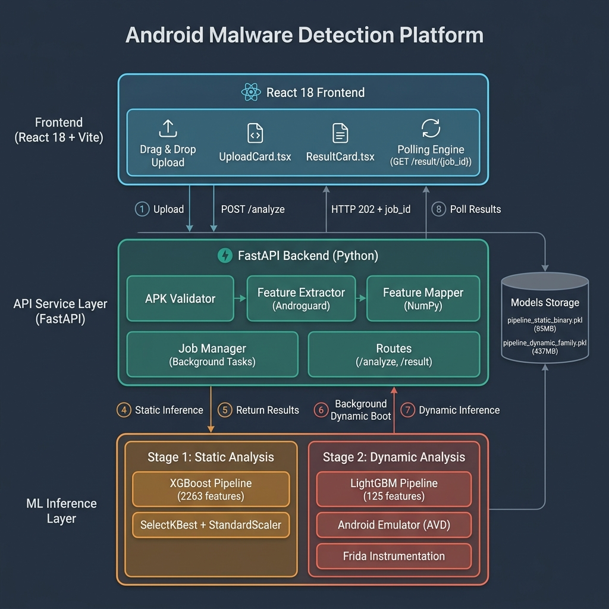

# AndroMal — Android 恶意软件检测平台

[](https://www.python.org/)
[](https://react.dev/)
[](https://fastapi.tiangolo.com/)
[](https://docs.docker.com/compose/)

AndroMal 是一个面向安全研究和比赛演示的 Android APK 分析平台。后端通过 Androguard 提取静态特征，调用 Scikit-learn/XGBoost 模型完成恶意性与家族预测；前端采用 React、TypeScript 和 ECharts，提供类似 MobSF 的上传、风险总览、权限、组件及模型置信度报告。

本仓库基于 [yuvrajSingh-rajput/andro-mal](https://github.com/yuvrajSingh-rajput/andro-mal) 进行二次开发，主要补充了 MobSF 风格前端、结构化分析报告、部署配置和本地启动工具。

> 本项目仅用于获得授权的安全测试、教学和科研。不要上传、运行或分析无权处理的 APK。

## 功能

- APK 拖拽上传与分析任务状态跟踪
- 应用元数据、哈希、DEX、权限和组件统计
- 静态恶意性检测与风险等级展示
- 恶意软件家族概率及可视化图表
- 响应式 MobSF 风格工作台
- FastAPI 健康检查和接口文档
- Windows 本地开发启动脚本
- Docker Compose 一键部署
- Git LFS 管理大型模型文件

## 系统架构

<p align="center">
  
</p>

```text
浏览器
  │
  ├─ 本地开发：http://127.0.0.1:5173
  │                └─ HTTP API → http://127.0.0.1:8000
  │
  └─ Docker 部署：http://服务器地址
                   └─ /api/* → Nginx → backend:8000
                                             ├─ Androguard
                                             └─ ML models
```

## 目录结构

```text
andro-mal/
├─ backend/              FastAPI 接口、特征提取和推理服务
├─ dynamic/              动态分析相关模块
├─ frontend/             React + TypeScript + Vite 前端
├─ models/               模型文件和训练评估图
├─ scripts/              Windows 本地启动脚本
├─ tests/                后端测试
├─ docker-compose.yml    前后端容器编排
└─ requirements.txt      Python 依赖
```

## 环境要求

### 推荐：Docker 部署

- Git
- Git LFS
- Docker Desktop，或 Linux Docker Engine
- Docker Compose v2
- 建议至少预留 4 GB 内存和 2 GB 磁盘空间

### 本地开发

- Python 3.11
- Node.js 22
- npm
- Git LFS

模型目录中包含超过 100 MB 的文件。克隆后必须执行 `git lfs pull`，否则得到的可能只是 LFS 指针文件，后端无法加载模型。

## 部署方式一：Docker Compose（推荐）

### 1. 克隆代码和模型

```bash
git lfs install
git clone https://github.com/come-to-be-WuTai-cat/andro-mal.git
cd andro-mal
git lfs pull
```

### 2. 构建并启动

```bash
docker compose up --build -d
```

第一次构建需要安装 Python、Node 和系统依赖，耗时取决于网络与机器性能。

### 3. 检查服务

```bash
docker compose ps
docker compose logs -f
```

可访问地址：

- Web 前端：<http://localhost>
- 后端健康检查：<http://127.0.0.1:8000/health>
- FastAPI 文档：<http://127.0.0.1:8000/docs>

生产构建中的浏览器请求使用同源 `/api`，由 Nginx 转发到 Compose 网络内的 `backend:8000`。因此远程访问者不会错误请求自己电脑上的 `localhost:8000`。

### 4. 停止或更新

```bash
# 停止
docker compose down

# 拉取新版本并重建
git pull
git lfs pull
docker compose up --build -d
```

## 部署到 Linux 服务器

以下命令以 Ubuntu/Debian 为例。先安装 Git、Git LFS、Docker Engine 和 Compose 插件，然后执行：

```bash
git lfs install
git clone https://github.com/come-to-be-WuTai-cat/andro-mal.git
cd andro-mal
git lfs pull
sudo docker compose up --build -d
sudo docker compose ps
```

服务器防火墙至少开放 TCP 80。Compose 默认只把后端端口绑定到服务器的 `127.0.0.1:8000`，外部用户通过前端的 `/api` 访问后端，避免直接暴露推理接口。

如需域名和 HTTPS，建议在本项目外层增加 Caddy、Traefik 或宿主机 Nginx，并把域名反向代理到 `http://127.0.0.1:80`。正式上线前还应增加身份认证、上传频率限制、文件大小策略和日志轮转。

## 部署方式二：Windows 本地开发

### 1. 初始化后端

在项目根目录打开 PowerShell：

```powershell
py -3.11 -m venv .venv
.\.venv\Scripts\python.exe -m pip install --upgrade pip
.\.venv\Scripts\python.exe -m pip install -r requirements.txt
```

### 2. 初始化前端

```powershell
npm --prefix frontend ci
```

### 3. 一键启动

```powershell
.\scripts\start-local.cmd
```

脚本会打开两个命令窗口：

- 前端：<http://127.0.0.1:5173>
- 后端：<http://127.0.0.1:8000>
- 接口文档：<http://127.0.0.1:8000/docs>

运行期间不要关闭这两个窗口。停止服务时，在两个窗口中分别按 `Ctrl+C`。

也可以分别手动启动：

```powershell
# 终端 1：后端
.\.venv\Scripts\python.exe -m uvicorn backend.app.main:app --host 127.0.0.1 --port 8000

# 终端 2：前端
cd frontend
npm run dev -- --host 127.0.0.1 --port 5173
```

## 配置说明

| 配置 | 默认值 | 用途 |
|---|---:|---|
| `VITE_API_URL` | 本地为 `http://localhost:8000` | 前端 API 根地址 |
| Docker `VITE_API_URL` | `/api` | 交给 Nginx 同源代理 |
| `PORT` | `8000` | 后端容器监听端口 |
| `DOCKER_MODE` | `true` | 标识容器运行环境 |

如果单独构建前端镜像并连接其他 API，可以覆盖构建参数：

```bash
docker build -f frontend/Dockerfile \
  --build-arg VITE_API_URL=https://api.example.com \
  -t andromal-frontend .
```

## 验证与测试

```powershell
# 后端测试
.\.venv\Scripts\python.exe -m pytest -q

# 前端检查
npm --prefix frontend run lint
npm --prefix frontend run build
```

健康检查：

```bash
curl http://127.0.0.1:8000/health
curl -I http://127.0.0.1
```

## 常见问题

### 浏览器显示 `ERR_CONNECTION_REFUSED`

这表示对应端口没有进程监听。确认前端窗口出现 `Local: http://127.0.0.1:5173/`，后端窗口出现 `Application startup complete`，并保持两个窗口开启。

### 后端提示模型无法加载

先检查模型是否由 Git LFS 完整下载：

```bash
git lfs pull
git lfs ls-files
```

如果 `.pkl` 文件只有几百字节，则仍是 LFS 指针，需要重新执行 `git lfs pull`。

### Docker 前端返回 502

后端首次加载大型模型可能需要较长时间。使用下面的命令观察健康状态和日志：

```bash
docker compose ps
docker compose logs -f backend
```

### 端口被占用

本地开发需要 `5173` 和 `8000`；Docker 部署需要 `80` 和本机回环地址上的 `8000`。关闭占用端口的旧进程，或修改启动参数和 `docker-compose.yml` 的端口映射。

## 模型与 Git LFS

`.gitattributes` 已配置所有 `*.pkl` 文件使用 Git LFS。提交模型前可执行：

```bash
git lfs install
git lfs track "*.pkl"
git add .gitattributes models
```

GitHub 免费账户的 LFS 存储和流量存在配额。比赛展示前请在目标电脑上提前执行 `git lfs pull`，避免现场下载模型失败。

## 致谢与说明

- 上游项目：[yuvrajSingh-rajput/andro-mal](https://github.com/yuvrajSingh-rajput/andro-mal)
- 界面信息架构参考：[MobSF](https://github.com/MobSF/Mobile-Security-Framework-MobSF)
- 数据集：CIC-AndMal-2020

上游仓库当前未展示明确的开源许可证。本仓库不额外声明或推定上游代码的许可证；公开发布、再分发或商业使用前，请先确认获得上游作者授权。

